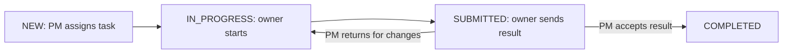
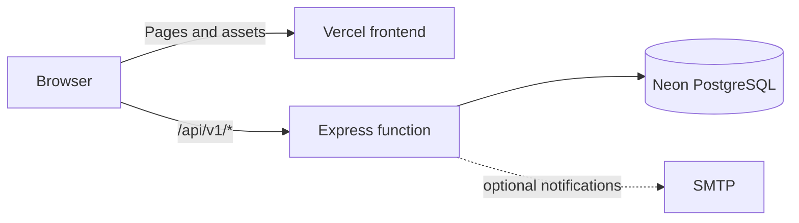

# CVRDE · Work Management Pilot

A role-based workspace for an **engine component development project**. Project managers plan the work, scientists carry it out, and reviewers approve decisions. Tasks, evidence, requests, and reports stay connected in one place.

> **Demo project:** The accounts and project data are fictional. The shared password is intentionally public. Use a dedicated demo database.

| 🌐 Live frontend | 🔎 API check |
|---|---|
| [biztel-ai-cvrde.vercel.app](https://biztel-ai-cvrde.vercel.app/) | [Check `/health`](https://biztel-ai-cvrde.vercel.app/health) |
| [cvrde-five.vercel.app](https://cvrde-five.vercel.app/) | [Check `/health`](https://cvrde-five.vercel.app/health) |

Both URLs serve the same app. A visible login page does not mean the API is ready; `/health` must respond successfully before sign in can work.

## ✨ What the project does

| Area | What users can do |
|---|---|
| Projects and tasks | Create projects, assign tasks and subtasks, set priorities and due dates, and track status. |
| Collaboration | Comment, share work with groups, and see a task's activity history. |
| Reviews | Submit results, return them for changes, accept them, and review reassignment or due-date requests. |
| Prerequisites | Link blocked work inside task detail, request approval, and resolve it from Review. |
| Evidence | Upload versioned project documents and task attachments; access follows project permissions. |
| Oversight | Use role-based dashboards, pending-action queues, progress and overdue reports, and CSV exports. |

The interface uses a fixed, collapsible sidebar, light and dark themes, and **Cmd/Ctrl + K** to find pages and tasks.

### 👥 Demo roles

| Role | Username | Main view |
|---|---|---|
| Project manager | `pm.demo` | Portfolio overview, assignments, approvals, reports |
| Scientist | `scientist1.demo` | Own and shared tasks, results, requests |
| Scientist | `scientist2.demo` | Own and shared tasks, results, requests |
| Reviewer | `reviewer.demo` | Reassignment decisions in Review |

**Shared password:** `CVRDE-Demo-2026!`

Choose an account on the login page to fill both fields. The password is also shown there if the API is temporarily unavailable.

## 🧭 From ticket to closure

The UI calls a work ticket a **task**. The task table shows due date, owner, status, and what a task is **linked to**. A prerequisite or blocker is recorded inside the task detail and routed to the Project Manager for approval. A task closes when the Project Manager accepts its submitted result.



| Decision | Raised by | Decided or resolved by | Effect |
|---|---|---|---|
| Result review | Task owner submits one result description | Project Manager accepts or returns | Acceptance completes the task; return allows another result version. |
| Due date extension | Task owner requests a later date | Project Manager approves or rejects in **Review** | Approval updates the due date. |
| Reassignment | Scientist requests another team member with a reason and work window; PM can also request | Scientist request: Project Manager. PM request: Reviewer | Approval changes the owner. The work window is recorded; it does not automatically revert ownership. |
| Prerequisite or pendency | Task owner links a task they are waiting on and names the responsible person | Project Manager approves or rejects; responsible member resolves | The request and its state remain visible inside the task detail. |

### 👨‍💼 Project Manager — `pm.demo`

| Step | Where | What to do |
|---|---|---|
| 1. Set up work | **Projects → New project / Edit project**, then **Settings** | Create a project with a deadline. Managers can edit its name, description, and deadline; the new deadline must remain after all task due dates and pending extensions. In Settings, add existing user accounts to its team and groups manually, or import an Excel sheet with `username` and optional `group` columns. Configure group permissions there. |
| 2. Create tasks | **Tasks → New task** | Choose owner, due date before the project deadline, priority, optional **Linked to** task, description, and sharing group. The task starts in **New**. Open a task and select **Edit task** to change its details. |
| 3. Monitor | **Overview**, **Tasks** | Follow totals, overdue work, and the task table. Open a task for progress, files, requests, comments, and history. |
| 4. Review requests | **Review** | Filter by request type or task. Approve or reject employee reassignment, due date extension, and prerequisite requests. Return or accept results. |
| 5. Request a reviewer decision | **Task detail → Reassignment** | Select a new owner, Reviewer, work window, and reason. Reviewer approval changes ownership. |
| 6. Report and audit | **Reports**, **Task history** | Filter reports, export CSV, and inspect the task event trail. **Reports** is available only to the Project Manager. |

### 🔬 Scientist One — `scientist1.demo`

| Step | Where | What to do |
|---|---|---|
| 1. Find work | **Tasks** | Use the table to check due dates and linked tasks. Open owned or permitted shared work. |
| 2. Start and document | **Task detail → Task and progress** | Select **In progress** from the status dropdown. Edit the description, comment, and upload evidence. |
| 3. Add a prerequisite | **Task detail → Requests and prerequisites** | Select the task being waited on, the responsible team member, type, and description. The Project Manager approves or rejects it in **Review**. |
| 4. Request changes | **Task detail → Requests and prerequisites** | Ask for a later due date or request reassignment to another member. The reassignment includes a work window and requires Project Manager approval. |
| 5. Submit work | **Task detail → Task and progress** | Select **Submit for review**, enter one result description, and submit. If returned, revise and submit another version. |

### 🧪 Scientist Two — `scientist2.demo`

Scientist Two has the same member permissions. The seeded project gives them different assignments and makes them responsible for example prerequisites.

| Step | Where | What to do |
|---|---|---|
| 1. Check assignments | **Tasks** | Read due dates and linked work in the table. Open owned or shared tasks. |
| 2. Resolve a prerequisite | **Review** | Select a resolution request and record what was done. The task detail retains the outcome. |
| 3. Take over work | **Tasks** | An approved reassignment appears under the new owner. The requested work window is shown in task detail. |
| 4. Deliver evidence | **Task detail** | Update status, comment, upload versioned files, and submit a result description for PM acceptance. |

### ✅ Reviewer — `reviewer.demo`

| Step | Where | What to do |
|---|---|---|
| 1. Open the queue | **Review** | Filter for **Reassignment**. Read the reason and requested work window. |
| 2. Decide | **Review** | Approve to change the owner, or reject to retain the current owner. The decision is written to task history. |
| 3. Hand work back | **Review** | The PM remains responsible for accepting the final result. |

### 🎬 Walk through all four accounts

Run `npm run seed` for a fresh fictional demonstration. Each step changes shared demo data.

| # | Account | Try this |
|---|---|---|
| 1 | **PM** | In **Projects**, create a project with a deadline. In **Settings**, add a group manually or import an Excel sheet with an existing username and group name. |
| 2 | **PM** | In **Tasks**, create a task with a due date before the project deadline and an optional **Linked to** task. |
| 3 | **Scientist One** | In **Tasks**, open it, select **In progress**, comment, and upload evidence. |
| 4 | **Scientist One → PM** | Add a prerequisite within task detail; approve it in **Review**. |
| 5 | **Scientist Two** | Resolve the approved prerequisite from **Review**. |
| 6 | **Scientist One → PM** | Submit one result description; PM returns it or accepts it in **Review**. |
| 7 | **Scientist One → PM** | Request a new owner with a work window; PM accepts or rejects from **Review**. |
| 8 | **PM → Reviewer** | Request reassignment on another task; the Reviewer decides it in **Review**. |

## 🧱 Tech stack

| Layer | Technology |
|---|---|
| Web app | React 18, TypeScript, Vite 7, Tailwind CSS 4, TanStack Query |
| Interface | shadcn-style Command, Radix Dialog, Lucide icons, Motion |
| Spreadsheet import | read-excel-file for browser-side `.xlsx` team and group import |
| API | Node.js, Express 4, TypeScript, Zod |
| Data | Neon PostgreSQL, `pg`, Kysely, SQL migrations |
| Hosting | One Vercel project for the frontend and Express function |
| Verification | Vitest, Supertest, Playwright, API smoke script |



Attachments are stored in PostgreSQL so downloads work across Vercel function instances.

## 🚀 Run locally

**Prerequisites:** Node.js, npm, and a Neon PostgreSQL database. Run all commands from the repository root.

1. Copy `.env.example` to `.env` in the **root** and set `DATABASE_URL` to your Neon connection string. The root `.env` is ignored by Git.
2. Install dependencies and prepare the fictional demo database:

   ```powershell
   npm install
   npm run migrate
   npm run seed
   ```

3. Start the web app and API together:

   ```powershell
   npm run dev
   ```

Open **http://localhost:5173**. The API runs at **http://localhost:3001**. Press `Ctrl+C` to stop both.

`npm run seed` resets the named fictional demo project and its four accounts. Run it again when you want a clean sample dataset or after changing the public password in [`backend/src/demo.ts`](backend/src/demo.ts).

### Useful commands

| Command | Purpose |
|---|---|
| `npm run dev` | Run frontend and backend with live reload |
| `npm run build` | Type-check and build both workspaces |
| `npm run migrate` | Apply PostgreSQL schema changes |
| `npm run seed` | Reset the fictional demo project and accounts |
| `npm run smoke` | Check login, demo data, and an attachment download |
| `npm run check:vercel-entry` | Check API rewrite paths against Express locally |
| `npm test` | Run API workflow tests; reseed afterward |

## ☁️ Deploy as one Vercel project

1. Import this repository into **one** Vercel project. Keep the repository root as the Root Directory. [`vercel.json`](vercel.json) builds `frontend/dist` and routes `/api/v1/*` to [`api/index.ts`](api/index.ts).
2. In **Project Settings → Environment Variables**, set `DATABASE_URL` for the environment serving your domain. No demo password environment variable is required.
3. From a machine with access to that **same Neon database**, run `npm run migrate` and then `npm run seed` before the first sign in. Migrate again when the schema changes. Seeding resets the fictional project.
4. Deploy or redeploy. Vercel applies changed environment variables to **new deployments**, not existing ones.
5. Open `/health` on the deployed domain, then sign in using a demo account.

The local `.env` is not uploaded to Vercel. If the two domains belong to different Vercel projects, configure each project. If they are aliases of one project, configure it once.

### 🧭 Deployment troubleshooting

| Symptom | Check |
|---|---|
| Login page loads, but `/health` returns `503` mentioning `DATABASE_URL` | Add `DATABASE_URL` to the correct Vercel environment, then redeploy. |
| `/health` returns `500` or `FUNCTION_INVOCATION_FAILED` | Inspect the Vercel function logs for an API initialization error. |
| `/health` works, but sign in fails | Run migrations and reseed the same Neon database used by Vercel. Confirm the four demo users exist. |
| Account names and password appear while API calls fail | Expected: login details are part of the frontend, but authentication still needs the API and database. |
| Existing file downloads fail after moving from disk storage | Run `npm run backfill:files` after migration to copy older attachments into PostgreSQL. |

New uploads are stored in PostgreSQL and limited to 4 MB for the Vercel request limit.

## 🗂️ Repository guide

| Path | Purpose |
|---|---|
| [`frontend/src/`](frontend/src/) | React screens, theme, command palette |
| [`backend/src/`](backend/src/) | Express routes, permissions, seed data, file handling |
| [`backend/migrations/`](backend/migrations/) | SQL schema migrations |
| [`api/index.ts`](api/index.ts) | Vercel function entry |
| [`docs/`](docs/) | [Acceptance checklist](docs/ACCEPTANCE.md), [handover](docs/HANDOVER.md), screenshots, and presentation |
| [`deploy/`](deploy/) | Optional Docker/Caddy self-hosting setup |

## ✉️ Optional email

The app records notifications without SMTP. For delivery, set `SMTP_HOST`, `SMTP_PORT`, `SMTP_USER`, `SMTP_PASSWORD`, and `SMTP_FROM`. To route demo messages to controlled inboxes, set `DEMO_EMAIL_PM`, `DEMO_EMAIL_S1`, `DEMO_EMAIL_S2`, and `DEMO_EMAIL_REVIEWER` before seeding.

The Docker/Caddy files are for self-hosting; Vercel uses the root `vercel.json` instead.
