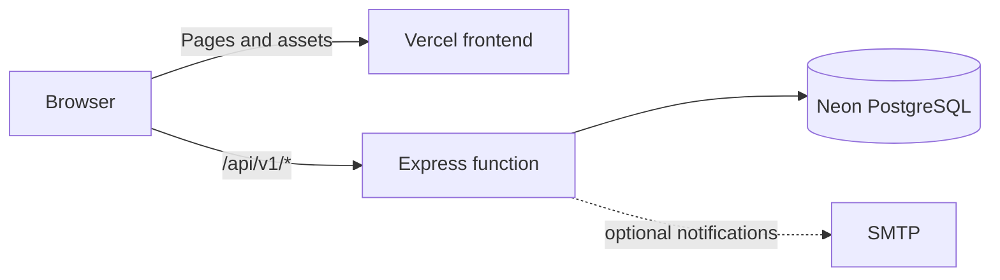

# CVRDE · Work Management Pilot

A role-based workspace for an **engine component development project**. Project managers plan the work, scientists carry it out, and reviewers approve decisions. Tasks, evidence, requests, and reports stay connected in one place.

> **Demo project:** The accounts and project data are fictional. The shared password is intentionally public. Use a dedicated demo database.

| 🌐 Live frontend | 🔎 API check |
|---|---|
| [biztel-ai-cvrde.vercel.app](https://biztel-ai-cvrde.vercel.app/) | [Check `/health`](https://biztel-ai-cvrde.vercel.app/health) |
| [cvrde-five.vercel.app](https://cvrde-five.vercel.app/) | [Check `/health`](https://cvrde-five.vercel.app/health) |

Both URLs serve the same app. A visible login page does not mean the API is ready; `/health` must respond successfully before sign in can work.

## ✨ What the project does

| Area | What users can do |
|---|---|
| Projects and tasks | Create projects, assign tasks and subtasks, set priorities and due dates, and track status. |
| Collaboration | Comment, share work with groups, and see a task's activity history. |
| Reviews | Submit results, return them for changes, accept them, and review reassignment or due-date requests. |
| Pendencies | Raise blockers or clarifications, approve them when required, and resolve them. |
| Evidence | Upload versioned project documents and task attachments; access follows project permissions. |
| Oversight | Use role-based dashboards, pending-action queues, progress and overdue reports, and CSV exports. |

The interface uses a fixed, collapsible sidebar, light and dark themes, and **Cmd/Ctrl + K** to find pages and tasks.

### 👥 Demo roles

| Role | Username | Main view |
|---|---|---|
| Project manager | `pm.demo` | Portfolio overview, assignments, approvals, reports |
| Scientist | `scientist1.demo` | Own and shared tasks, results, requests |
| Scientist | `scientist2.demo` | Own and shared tasks, results, requests |
| Reviewer | `reviewer.demo` | Pending review decisions |

**Shared password:** `CVRDE-Demo-2026!`

Choose an account on the login page to fill both fields. The password is also shown there if the API is temporarily unavailable.

## 🧱 Tech stack

| Layer | Technology |
|---|---|
| Web app | React 18, TypeScript, Vite 7, Tailwind CSS 4, TanStack Query |
| Interface | shadcn-style Command, Radix Dialog, Lucide icons, Motion |
| API | Node.js, Express 4, TypeScript, Zod |
| Data | Neon PostgreSQL, `pg`, Kysely, SQL migrations |
| Hosting | One Vercel project for the frontend and Express function |
| Verification | Vitest, Supertest, Playwright, API smoke script |



Attachments are stored in PostgreSQL so downloads work across Vercel function instances.

## 🚀 Run locally

**Prerequisites:** Node.js, npm, and a Neon PostgreSQL database. Run all commands from the repository root.

1. Copy `.env.example` to `.env` in the **root** and set `DATABASE_URL` to your Neon connection string. The root `.env` is ignored by Git.
2. Install dependencies and prepare the fictional demo database:

   ```powershell
   npm install
   npm run migrate
   npm run seed
   ```

3. Start the web app and API together:

   ```powershell
   npm run dev
   ```

Open **http://localhost:5173**. The API runs at **http://localhost:3001**. Press `Ctrl+C` to stop both.

`npm run seed` resets the named fictional demo project and its four accounts. Run it again when you want a clean sample dataset or after changing the public password in [`backend/src/demo.ts`](backend/src/demo.ts).

### Useful commands

| Command | Purpose |
|---|---|
| `npm run dev` | Run frontend and backend with live reload |
| `npm run build` | Type-check and build both workspaces |
| `npm run migrate` | Apply PostgreSQL schema changes |
| `npm run seed` | Reset the fictional demo project and accounts |
| `npm run smoke` | Check login, demo data, and an attachment download |
| `npm run check:vercel-entry` | Check API rewrite paths against Express locally |
| `npm test` | Run API workflow tests; reseed afterward |

## ☁️ Deploy as one Vercel project

1. Import this repository into **one** Vercel project. Keep the repository root as the Root Directory. [`vercel.json`](vercel.json) builds `frontend/dist` and routes `/api/v1/*` to [`api/index.ts`](api/index.ts).
2. In **Project Settings → Environment Variables**, set `DATABASE_URL` for the environment serving your domain. No demo password environment variable is required.
3. From a machine with access to that **same Neon database**, run `npm run migrate` and then `npm run seed` before the first sign in. Migrate again when the schema changes. Seeding resets the fictional project.
4. Deploy or redeploy. Vercel applies changed environment variables to **new deployments**, not existing ones.
5. Open `/health` on the deployed domain, then sign in using a demo account.

The local `.env` is not uploaded to Vercel. If the two domains belong to different Vercel projects, configure each project. If they are aliases of one project, configure it once.

### 🧭 Deployment troubleshooting

| Symptom | Check |
|---|---|
| Login page loads, but `/health` returns `503` mentioning `DATABASE_URL` | Add `DATABASE_URL` to the correct Vercel environment, then redeploy. |
| `/health` returns `500` or `FUNCTION_INVOCATION_FAILED` | Inspect the Vercel function logs for an API initialization error. |
| `/health` works, but sign in fails | Run migrations and reseed the same Neon database used by Vercel. Confirm the four demo users exist. |
| Account names and password appear while API calls fail | Expected: login details are part of the frontend, but authentication still needs the API and database. |
| Existing file downloads fail after moving from disk storage | Run `npm run backfill:files` after migration to copy older attachments into PostgreSQL. |

New uploads are stored in PostgreSQL and limited to 4 MB for the Vercel request limit.

## 🗂️ Repository guide

| Path | Purpose |
|---|---|
| [`frontend/src/`](frontend/src/) | React screens, theme, command palette |
| [`backend/src/`](backend/src/) | Express routes, permissions, seed data, file handling |
| [`backend/migrations/`](backend/migrations/) | SQL schema migrations |
| [`api/index.ts`](api/index.ts) | Vercel function entry |
| [`docs/`](docs/) | [Acceptance checklist](docs/ACCEPTANCE.md), [handover](docs/HANDOVER.md), screenshots, and presentation |
| [`deploy/`](deploy/) | Optional Docker/Caddy self-hosting setup |

## ✉️ Optional email

The app records notifications without SMTP. For delivery, set `SMTP_HOST`, `SMTP_PORT`, `SMTP_USER`, `SMTP_PASSWORD`, and `SMTP_FROM`. To route demo messages to controlled inboxes, set `DEMO_EMAIL_PM`, `DEMO_EMAIL_S1`, `DEMO_EMAIL_S2`, and `DEMO_EMAIL_REVIEWER` before seeding.

The Docker/Caddy files are for self-hosting; Vercel uses the root `vercel.json` instead.
