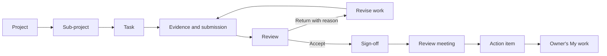

# CVRDE Work Management Demo

A fictional engine development programme showing how a PM structures work, assigns tasks, reviews evidence, signs off results, and follows up on meetings. **Use fictional data only:** the public demo accounts are not for real CVRDE or DRDO information.

[Open the live demo](https://biztel-ai-cvrde.vercel.app/)

## 📚 Documentation

| Guide | What it covers |
|---|---|
| [Project and features](docs/PROJECT.md) | Purpose, roles, permissions, screens, workflow, demo scope |
| [Technology and architecture](docs/TECH_STACK.md) | Stack, data model, security, storage, repository map |
| [Demo walkthrough](docs/DEMO_GUIDE.md) | Accounts, eight-step story, sample files, reset, verification |
| [Setup and deployment](docs/SETUP.md) | Local development, Vercel, Docker LAN, commands, checks |
| [Configuration](docs/CONFIGURATION.md) | Environment variables, Resend and SMTP, `VITE_DEMO_MODE` |

## 🚀 Quick start

1. Run `npm install`.
2. Copy `.env.example` to `.env` and set `DATABASE_URL` for a **dedicated demo database**.
3. Run `npm run reset:demo` to migrate and seed the fictional programme.

The reset removes the named disposable projects (`Engine Component Development — Demo`, `Sample1`, `ABC`, `123`, `SAM`). It preserves `TEAL_DEMO`, `BiztelAI_Work`, and any unrelated project. The demo interface opens Engine Development Programme only.
4. Run `npm run dev`, then open `http://localhost:5173`.

On the sign-in screen, choose a demo person; the form fills their credentials. Read the [setup guide](docs/SETUP.md) before using an existing or hosted database: resetting replaces the named fictional demo projects.

> **Demo UI:** PMs land on a project overview and can switch between projects they manage from the sidebar. Other PMs' projects are hidden. Sub-project owners land on their own sub-project, and task owners on My work. Task owners can choose peer tasks only from the dependency picker inside an owned task. `VITE_DEMO_MODE` defaults to on; set it to `false` **before building the frontend** to show deferred controls. See [configuration](docs/CONFIGURATION.md#demo-mode).

## 🧭 At a glance

The app uses React and TypeScript, an Express API, PostgreSQL, and a configurable email provider. In-app notifications and the audit trail record the work loop. The [technology guide](docs/TECH_STACK.md) has the full stack.
