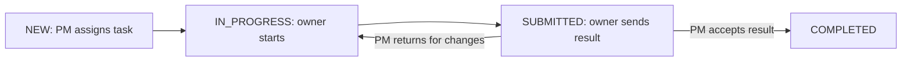
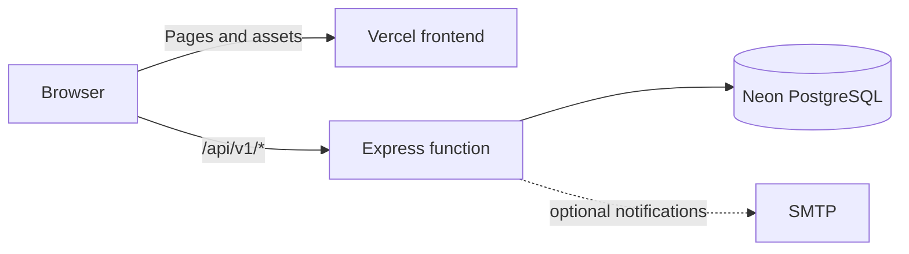

# CVRDE · Work Management Pilot

A role-based workspace for an **engine component development project**. Project managers plan the work, scientists carry it out, and reviewers approve decisions. Tasks, evidence, requests, and reports stay connected in one place.

> **Demo project:** The accounts and project data are fictional. The shared password is intentionally public. Use a dedicated demo database.

| 🌐 Live frontend | 🔎 API check |
|---|---|
| [biztel-ai-cvrde.vercel.app](https://biztel-ai-cvrde.vercel.app/) | [Check `/health`](https://biztel-ai-cvrde.vercel.app/health) |
| [cvrde-five.vercel.app](https://cvrde-five.vercel.app/) | [Check `/health`](https://cvrde-five.vercel.app/health) |

Both URLs serve the same app. A visible login page does not mean the API is ready; `/health` must respond successfully before sign in can work.

## ✨ What the project does

| Area | What users can do |
|---|---|
| Projects and tasks | Create projects, assign tasks and subtasks, set priorities and due dates, and track status. |
| Collaboration | Comment, share work with groups, and see a task's activity history. |
| Reviews | Submit results, return them for changes, accept them, and review reassignment or due-date requests. |
| Pendencies | Raise blockers or clarifications, approve them when required, and resolve them. |
| Evidence | Upload versioned project documents and task attachments; access follows project permissions. |
| Oversight | Use role-based dashboards, pending-action queues, progress and overdue reports, and CSV exports. |

The interface uses a fixed, collapsible sidebar, light and dark themes, and **Cmd/Ctrl + K** to find pages and tasks.

### 👥 Demo roles

| Role | Username | Main view |
|---|---|---|
| Project manager | `pm.demo` | Portfolio overview, assignments, approvals, reports |
| Scientist | `scientist1.demo` | Own and shared tasks, results, requests |
| Scientist | `scientist2.demo` | Own and shared tasks, results, requests |
| Reviewer | `reviewer.demo` | Pending review decisions |

**Shared password:** `CVRDE-Demo-2026!`

Choose an account on the login page to fill both fields. The password is also shown there if the API is temporarily unavailable.

## 🧭 From ticket to closure

The UI calls a work ticket a **task**. A blocker or request for another person is a **pendency**. The Project Manager creates tasks; a Scientist owns and works each task; the Project Manager closes it by accepting its submitted result. There is no separate “Close ticket” button.



| Decision | Raised by | Decided or resolved by | Effect |
|---|---|---|---|
| Result review | Task owner submits work and outcome | Project Manager accepts or returns | Accept completes the task; return moves it back to **In Progress** for another result version. |
| Due-date extension | Task owner requests a later date and gives a reason | Project Manager approves or rejects | Approval changes the task due date; rejection leaves it as it was. |
| Reassignment | Project Manager proposes a new project member and gives a reason | Reviewer approves or rejects | Approval changes the owner; rejection keeps the current owner. |
| Pendency | Task owner selects a blocked task, a visible dependency, and a responsible member | Project Manager approves or rejects; responsible member resolves an approved pendency | Approval opens the pendency; resolution closes the blocker. The task still needs a submitted and accepted result. |

### 👨‍💼 Project Manager — `pm.demo`

| Step | Where | What to do |
|---|---|---|
| 1. Prepare the project | **Projects** | Select the seeded project or create one. Add Scientist One and Scientist Two as members. Create groups and set sharing permissions when work must be visible to a team. |
| 2. Raise a task | **Projects → Tasks** | Enter title and description, choose an owner, priority and due date, and optionally select a parent task. **Create task** puts it in **New**. |
| 3. Track work | **Overview**, **Tasks**, **Projects** | Check total, completed and overdue counts; open a task to read comments, files, result versions, and history. Upload project documents from **Projects**. |
| 4. Handle blockers and dates | **Pending** or **Task detail** | Approve or reject a Scientist’s pendency and due-date extension. Approved pendencies move to the responsible person’s queue. |
| 5. Request a new owner | **Task detail → Reassignment** | Choose another project member and the Reviewer, enter a reason, and send the request. The owner changes only if the Reviewer approves. |
| 6. Close the task | **Pending → Result review** or **Task detail → Status & results** | **Return** a result for corrections, or **Accept** it. Acceptance changes the task to **Completed**. |
| 7. Report and audit | **Reports**, **Task detail → Task history** | Filter progress or overdue reports and export CSV. Inspect the activity trail and export a task’s history when needed. |

### 🔬 Scientist One — `scientist1.demo`

| Step | Where | What to do |
|---|---|---|
| 1. Pick up work | **Tasks → My and shared tasks** | Open an owned task. Shared group tasks may be visible too, but only the owner can start or submit its result. |
| 2. Start and document | **Task detail** | Click **Start task** on a **New** task. Add progress comments, update details, and upload evidence. Reuse a document key to add another file version. |
| 3. Raise a blocker | **Pendencies → Raise a pendency** | Choose your blocked task, a visible task it depends on, a responsible member such as Scientist Two, the type, and a description. The Project Manager reviews it; the responsible member resolves it if approved. |
| 4. Request more time | **Task detail → Due date extensions** | Enter a later date and reason, then **Request extension**. Watch for the Project Manager’s decision. |
| 5. Submit work | **Task detail → Status & results** | When the task is **In Progress**, describe work completed and its outcome, then **Submit for PM review**. The task becomes **Submitted**. |
| 6. Finish corrections | **Task detail → Status & results** | If the Project Manager returns the result, read the comment, update the work, and submit another version. The task is **Completed** only after acceptance. |

### 🧪 Scientist Two — `scientist2.demo`

Scientist Two has the **same member permissions** as Scientist One. The seeded project gives them different tasks and makes them the responsible person in example blockers.

| Step | Where | What to do |
|---|---|---|
| 1. Check assignments | **Tasks** | Open owned or permitted shared tasks. The seed includes tasks such as **Thermal analysis report** and **Instrumentation readiness review**. |
| 2. Clear a blocker | **Pending → Pendency resolve** | When the Project Manager approves a pendency assigned to you, click **Resolve** and record the resolution. The status becomes **Resolved** and the raiser is notified. |
| 3. Take over approved work | **Tasks** | If the Reviewer approves a reassignment to you, the task appears under your ownership. Start it if **New**, continue if **In Progress**, or await the Project Manager’s decision if **Submitted**. |
| 4. Deliver evidence | **Task detail** | Comment, upload versioned files, request an extension if needed, and submit a result. If a result is returned, revise and resubmit it for Project Manager acceptance. |

### ✅ Reviewer — `reviewer.demo`

| Step | Where | What to do |
|---|---|---|
| 1. Open the queue | **Pending → Pending my action** | Find **Reassignment** requests. **View task** may show limited task information needed for this decision. |
| 2. Decide | **Pending** | **Approve** to assign the task to the proposed Scientist, or **Reject** to keep its current owner. The decision appears in task history and notifies the people involved. |
| 3. Hand work back | **Tasks / Pending** | The new owner works an approved task. The Project Manager, not the Reviewer, accepts the final result and completes the task. |

### 🎬 Walk through all four accounts

Start with `npm run seed` if you want the original fictional tasks and statuses. Each step changes shared demo data.

| # | Account | Try this |
|---|---|---|
| 1 | **PM** | In **Projects**, create a task assigned to Scientist One. Give it a due date and optional parent task. |
| 2 | **Scientist One** | In **Tasks**, open it, click **Start task**, add a comment, and upload a file. |
| 3 | **Scientist One** | In **Pendencies**, raise a blocker on an owned task, link a visible task, and choose Scientist Two as responsible. |
| 4 | **PM** | In **Pending**, approve the pendency. If Scientist One requested a due-date extension, approve or reject that separately. |
| 5 | **Scientist Two** | In **Pending**, resolve the approved pendency with a written resolution. |
| 6 | **Scientist One** | Return to the task and submit **Work completed** and **Outcome** for review. |
| 7 | **PM → Scientist One → PM** | Return the result with a comment; have Scientist One revise and submit a new version; then **Accept** it. The task becomes **Completed**. |
| 8 | **PM → Reviewer → Scientist Two** | On a different task, have PM request reassignment to Scientist Two. Reviewer approves in **Pending**; Scientist Two becomes its owner and can continue the work. |

## 🧱 Tech stack

| Layer | Technology |
|---|---|
| Web app | React 18, TypeScript, Vite 7, Tailwind CSS 4, TanStack Query |
| Interface | shadcn-style Command, Radix Dialog, Lucide icons, Motion |
| API | Node.js, Express 4, TypeScript, Zod |
| Data | Neon PostgreSQL, `pg`, Kysely, SQL migrations |
| Hosting | One Vercel project for the frontend and Express function |
| Verification | Vitest, Supertest, Playwright, API smoke script |



Attachments are stored in PostgreSQL so downloads work across Vercel function instances.

## 🚀 Run locally

**Prerequisites:** Node.js, npm, and a Neon PostgreSQL database. Run all commands from the repository root.

1. Copy `.env.example` to `.env` in the **root** and set `DATABASE_URL` to your Neon connection string. The root `.env` is ignored by Git.
2. Install dependencies and prepare the fictional demo database:

   ```powershell
   npm install
   npm run migrate
   npm run seed
   ```

3. Start the web app and API together:

   ```powershell
   npm run dev
   ```

Open **http://localhost:5173**. The API runs at **http://localhost:3001**. Press `Ctrl+C` to stop both.

`npm run seed` resets the named fictional demo project and its four accounts. Run it again when you want a clean sample dataset or after changing the public password in [`backend/src/demo.ts`](backend/src/demo.ts).

### Useful commands

| Command | Purpose |
|---|---|
| `npm run dev` | Run frontend and backend with live reload |
| `npm run build` | Type-check and build both workspaces |
| `npm run migrate` | Apply PostgreSQL schema changes |
| `npm run seed` | Reset the fictional demo project and accounts |
| `npm run smoke` | Check login, demo data, and an attachment download |
| `npm run check:vercel-entry` | Check API rewrite paths against Express locally |
| `npm test` | Run API workflow tests; reseed afterward |

## ☁️ Deploy as one Vercel project

1. Import this repository into **one** Vercel project. Keep the repository root as the Root Directory. [`vercel.json`](vercel.json) builds `frontend/dist` and routes `/api/v1/*` to [`api/index.ts`](api/index.ts).
2. In **Project Settings → Environment Variables**, set `DATABASE_URL` for the environment serving your domain. No demo password environment variable is required.
3. From a machine with access to that **same Neon database**, run `npm run migrate` and then `npm run seed` before the first sign in. Migrate again when the schema changes. Seeding resets the fictional project.
4. Deploy or redeploy. Vercel applies changed environment variables to **new deployments**, not existing ones.
5. Open `/health` on the deployed domain, then sign in using a demo account.

The local `.env` is not uploaded to Vercel. If the two domains belong to different Vercel projects, configure each project. If they are aliases of one project, configure it once.

### 🧭 Deployment troubleshooting

| Symptom | Check |
|---|---|
| Login page loads, but `/health` returns `503` mentioning `DATABASE_URL` | Add `DATABASE_URL` to the correct Vercel environment, then redeploy. |
| `/health` returns `500` or `FUNCTION_INVOCATION_FAILED` | Inspect the Vercel function logs for an API initialization error. |
| `/health` works, but sign in fails | Run migrations and reseed the same Neon database used by Vercel. Confirm the four demo users exist. |
| Account names and password appear while API calls fail | Expected: login details are part of the frontend, but authentication still needs the API and database. |
| Existing file downloads fail after moving from disk storage | Run `npm run backfill:files` after migration to copy older attachments into PostgreSQL. |

New uploads are stored in PostgreSQL and limited to 4 MB for the Vercel request limit.

## 🗂️ Repository guide

| Path | Purpose |
|---|---|
| [`frontend/src/`](frontend/src/) | React screens, theme, command palette |
| [`backend/src/`](backend/src/) | Express routes, permissions, seed data, file handling |
| [`backend/migrations/`](backend/migrations/) | SQL schema migrations |
| [`api/index.ts`](api/index.ts) | Vercel function entry |
| [`docs/`](docs/) | [Acceptance checklist](docs/ACCEPTANCE.md), [handover](docs/HANDOVER.md), screenshots, and presentation |
| [`deploy/`](deploy/) | Optional Docker/Caddy self-hosting setup |

## ✉️ Optional email

The app records notifications without SMTP. For delivery, set `SMTP_HOST`, `SMTP_PORT`, `SMTP_USER`, `SMTP_PASSWORD`, and `SMTP_FROM`. To route demo messages to controlled inboxes, set `DEMO_EMAIL_PM`, `DEMO_EMAIL_S1`, `DEMO_EMAIL_S2`, and `DEMO_EMAIL_REVIEWER` before seeding.

The Docker/Caddy files are for self-hosting; Vercel uses the root `vercel.json` instead.
