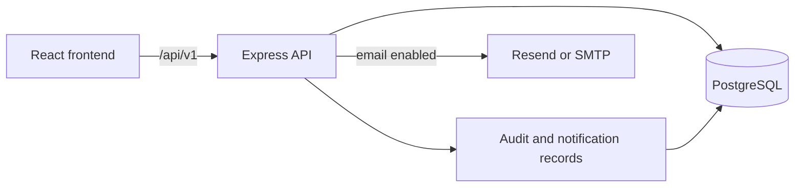

# Technology and architecture

[← Documentation index](../README.md)

## 🧱 Stack

| Layer | Technologies | Use |
|---|---|---|
| Web | React 18, TypeScript, Vite 7 | Role-based pages and production frontend build |
| UI | Tailwind CSS 4, local Manrope font, Lucide icons, Radix Dialog, Motion | Styling, accessible controls, icons, transitions |
| Client data | TanStack Query | Fetching and refreshing API state |
| API | Node.js, Express 4, TypeScript, Zod | Routes, validation, permissions, file endpoints |
| Database | PostgreSQL, Kysely, `pg`, SQL migrations | Projects, tasks, accounts, files, history, notifications |
| Auth | `bcryptjs`, cookie sessions | Password verification and HTTP-only session cookie |
| Email | Resend API or Nodemailer SMTP | Optional second notification channel |
| Tests | Vitest, Playwright, scripted checks | API workflows, browser flows, demo and deployment checks |
| Hosting | Vercel or Docker Compose with Caddy | Hosted demo or isolated LAN installation |

Packages and versions are in [frontend](../frontend/package.json) and [backend](../backend/package.json) manifests.

## 🔄 Request and data flow

Vercel routes `/api/v1/*` and `/health` to [`api/index.ts`](../api/index.ts) through [`vercel.json`](../vercel.json). Local development uses Vite's proxy to the API on port `3001`; the web app runs on port `5173`. The Docker LAN deployment runs web, API, PostgreSQL 18, and Caddy, with local assets and an internal application network.

## 🗄️ Data and permissions

The hierarchy is **Project → Sub-project → Task**. Tasks support `parent_task_id` for subtasks and `milestone_id` for milestones. Meeting action items are tasks with a meeting source. Results have review outcomes; attachments, comments, task history, audit events, and notification delivery records are stored in PostgreSQL. Project documents and task evidence are downloaded through authorized API endpoints.

Project documents and task evidence accept PDF, Office, CSV, text, common images, and engineering files (`.dxf`, `.mesh`, `.cdb`) up to 4 MB each. Downloads preserve the original filename and require access to the related project or task.

The API checks project membership and task access on protected routes. PM and sub-project-owner decisions are scoped to their project or sub-project. Session tokens are stored as hashes, with HTTP-only cookies; passwords are hashed. Inputs are validated with Zod. Email delivery status is `SENT`, `FAILED`, or `SKIPPED`; in-app notifications remain when email is off.

## 📁 Repository map

| Path | Purpose |
|---|---|
| [`frontend/src/`](../frontend/src/) | App shell, PM and user screens, task detail, meetings and milestones |
| [`backend/src/`](../backend/src/) | API routes, access rules, files, email, seed, database helpers |
| [`backend/migrations/`](../backend/migrations/) | PostgreSQL schema changes |
| [`api/index.ts`](../api/index.ts) | Vercel serverless API entry |
| [`deploy/`](../deploy/) | Docker Compose, Caddy, LAN and backup instructions |
| [`scripts/`](../scripts/) | Development helpers, checks, screenshots, demo recording |
| [`docs/`](./) | Product, setup, demo and acceptance material |

For commands and deployment, see [setup](SETUP.md). For environment variables, see [configuration](CONFIGURATION.md).
